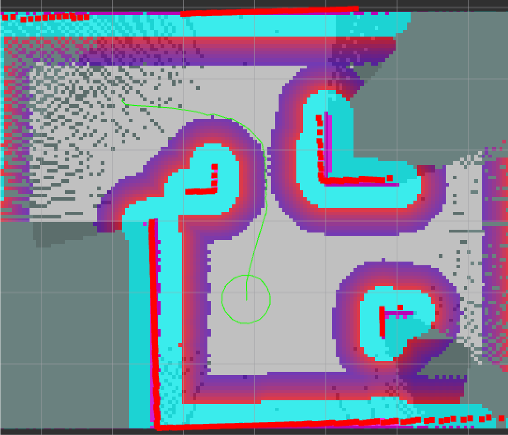
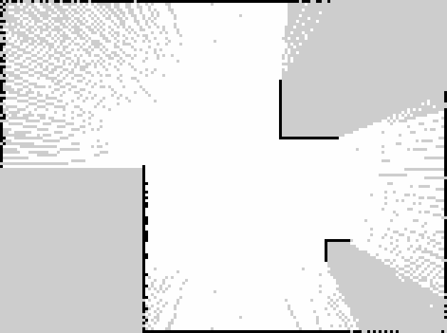

# 2D LiDAR SLAM and Autonomous Navigation with ROS 2 Jazzy

A differential-drive robot with a 2D LiDAR, built from scratch in Gazebo Harmonic. It maps an unknown room with **slam_toolbox**, then drives autonomously with **Nav2**, avoiding obstacles that were never on the map.



## What this project covers

| Area | What I did |
|---|---|
| Simulation | Built the room and the robot (chassis, two driven wheels, two casters, LiDAR) directly in SDF |
| ROS 2 integration | Bridged Gazebo and ROS 2 (`/scan`, `/cmd_vel`, `/odom`, `/tf`, `/clock`) with `ros_gz_bridge` |
| LiDAR processing | Wrote a node that reads `LaserScan` data and reports the closest obstacle overall and inside a 60° front cone |
| TF | Set up the frame chain `map → odom → base_footprint → lidar_link` |
| SLAM | Mapped the room with `slam_toolbox` and saved the map in the Nav2 format |
| Navigation | Configured Nav2 (AMCL, global and local costmaps, planner, controller) with my own parameter file |
| Obstacle avoidance | Spawned an obstacle that is not on the map; Nav2 detected it from the live scan and planned around it |

## Results



- **Map:** 157 × 117 cells at 5 cm = 7.85 × 5.85 m, matching the real 8 × 6 m room.
- **Navigation:** goals reached with 0 recovery behaviours, including a 4.45 m route that had to detour around an unmapped obstacle.
- **Localization:** the live scan stays aligned with the saved map during driving.

## Debugging story: where the "ghost walls" came from

My first maps contained extra diagonal walls and were about twice the real room size. Driving more slowly helped but did not fix it.

Checking the robot's ground-truth pose in Gazebo (`gz model -m robot -p`) showed a **pitch of 0.10 rad (about 6°)**. With the wheels in the middle of the chassis and only a rear caster, the robot tipped forward onto its nose. A LiDAR mounted 0.22 m high and tilted 6° down hits the floor about 2 m ahead, and reports the floor as a wall.

**Fix:** a second caster at the front. Pitch dropped to 0.00, the ghost walls disappeared, and the map shrank to the correct room size. The lesson: when sensor data looks wrong, check the mechanical setup before tuning algorithms.

Other problems I solved along the way:
- **Simulation clock frozen at 0:** six old Gazebo instances were still running in the background and publishing conflicting `/clock` messages. The start script now kills leftover processes first.
- **Costmap not visible in RViz:** the map topics use *Transient Local* durability (QoS), so the RViz display has to request it.
- **Nav2 planning through walls:** set `allow_unknown: false`, so goals in unexplored space are rejected.
- **Paths too close to walls:** set `robot_radius` to the robot's real size (0.33 m instead of the default 0.22 m).

## Repository structure

```
worlds/
  lidar_world.sdf        static LiDAR and two boxes (scan-processing basics)
  slam_world.sdf         8 x 6 m room + differential-drive robot with LiDAR
scripts/
  start_sim.sh           starts Gazebo, the bridge and the static TF frames
  closest_obstacle.py    LaserScan node: closest obstacle overall and in the front 60°
config/
  nav2_params.yaml       Nav2 parameters (initial pose, allow_unknown, robot radius)
  nav.rviz               RViz layout for navigation
maps/
  room_v2.pgm / .yaml    map produced by slam_toolbox
docs/                    screenshots
```

## How to run

Tested on Ubuntu 24.04 (WSL2) with ROS 2 Jazzy and Gazebo Harmonic.

```bash
sudo apt install ros-jazzy-ros-gz ros-jazzy-slam-toolbox ros-jazzy-navigation2 \
                 ros-jazzy-nav2-bringup ros-jazzy-teleop-twist-keyboard
source /opt/ros/jazzy/setup.bash
```

The scripts and configs use paths under `~/lidar_learning/`. Either copy the files there, or adjust the paths in `scripts/start_sim.sh`.

**1. Mapping**
```bash
./scripts/start_sim.sh                                                    # terminal 1
ros2 launch slam_toolbox online_async_launch.py use_sim_time:=true        # terminal 2
rviz2 -f map --ros-args -p use_sim_time:=true                             # terminal 3
ros2 run teleop_twist_keyboard teleop_twist_keyboard                      # terminal 4: drive slowly
ros2 run nav2_map_server map_saver_cli -f maps/room_v2 --ros-args -p save_map_timeout:=10.0
```

**2. Autonomous navigation** (restart the simulation first, so the robot starts at the map origin)
```bash
./scripts/start_sim.sh
ros2 launch nav2_bringup bringup_launch.py map:=$PWD/maps/room_v2.yaml \
     params_file:=$PWD/config/nav2_params.yaml use_sim_time:=true
rviz2 -d config/nav.rviz --ros-args -p use_sim_time:=true
```
Then click **2D Goal Pose** in RViz.

**3. Obstacle that is not on the map**
```bash
gz service -s /world/slam_world/create --reqtype gz.msgs.EntityFactory --reptype gz.msgs.Boolean --timeout 2000 \
  --req 'sdf: "<sdf version=\"1.9\"><model name=\"box\"><static>true</static><pose>-0.7 0.6 0.25 0 0 0</pose><link name=\"l\"><collision name=\"c\"><geometry><box><size>0.4 0.4 0.5</size></box></geometry></collision><visual name=\"v\"><geometry><box><size>0.4 0.4 0.5</size></box></geometry></visual></link></model></sdf>"'
```

## Limitations

- Simulation only; no real robot hardware.
- One small room; no long corridors or large loop closures were tested.
- The robot model is a simple box with wheels, not a commercial robot description (URDF).

## Skills

ROS 2 Jazzy · Gazebo Harmonic · 2D LiDAR · slam_toolbox · Nav2 · AMCL · costmaps · TF2 · RViz2 · Python (rclpy) · SDF robot modelling

---
Built by Aayush Safi as a self-study project alongside an M.Sc. in Information Technology at TH OWL, Germany.
